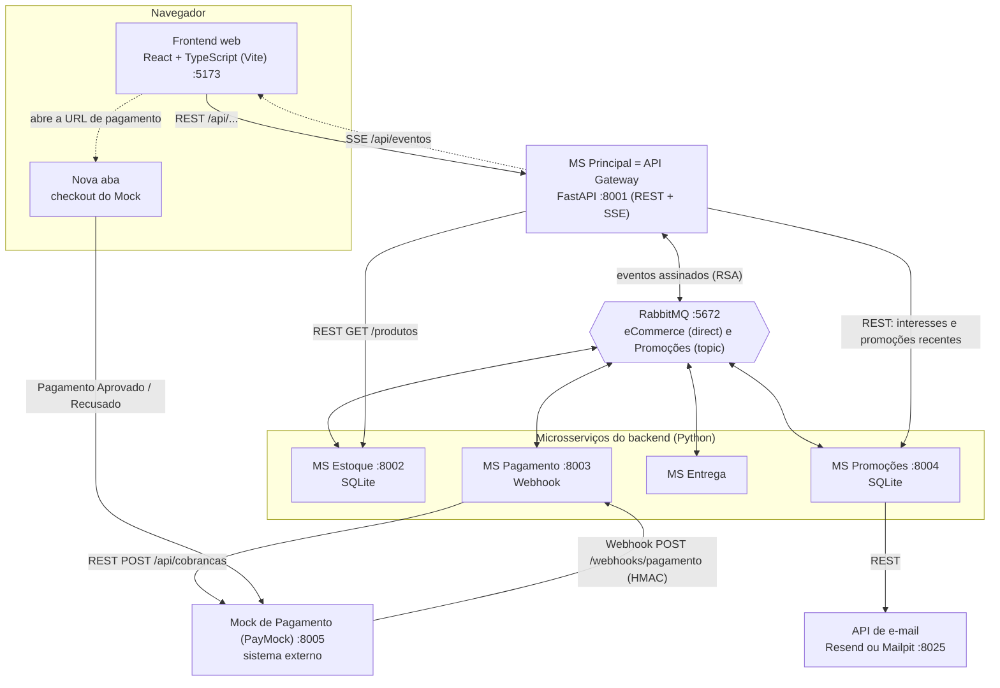
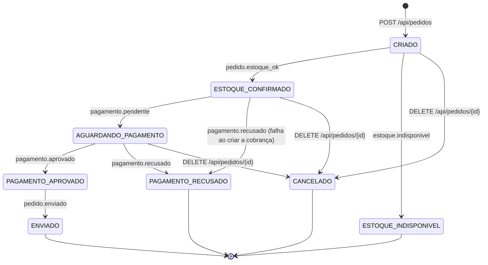
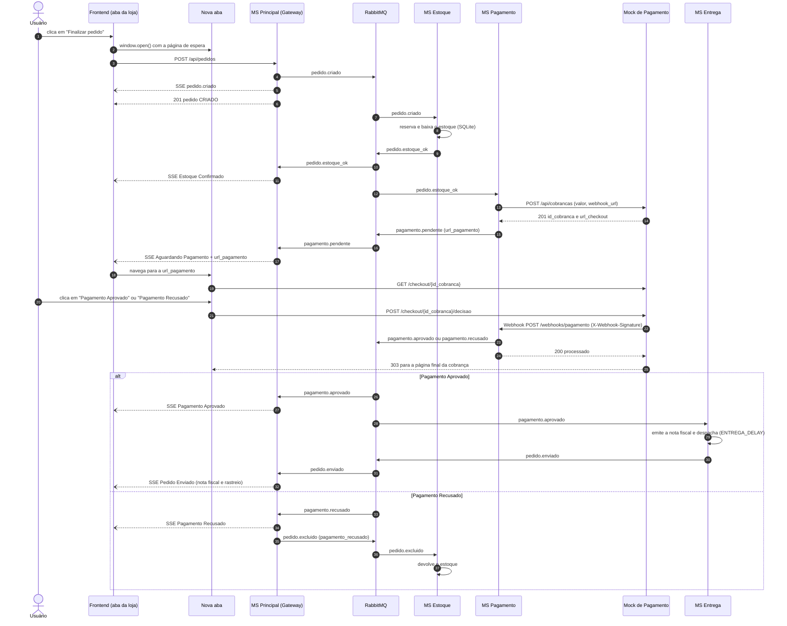

# Loja SD — e-commerce com microsserviços, RabbitMQ, REST e SSE

Trab2 de Sistemas Distribuídos (UTFPR). O projeto evolui o e-commerce do **Trab1**, em que os
microsserviços Python conversavam só por eventos no RabbitMQ com envelopes assinados
digitalmente, para uma **aplicação Web completa**:

- **Frontend web** em React + TypeScript, linguagem diferente da do backend. Usa **REST** para
  catálogo, pedidos e promoções e **SSE** para acompanhar os pedidos em tempo real.
- **MS Principal**, o **API Gateway** (FastAPI). Expõe a API REST, mantém as conexões SSE e
  traduz as ações do usuário em eventos no RabbitMQ.
- **MS Estoque, MS Pagamento, MS Entrega e MS Promoções**. Comunicam-se entre si apenas pelo
  **RabbitMQ**, com **assinatura digital RSA** em todas as mensagens.
- **Mock de Pagamento** (sistema externo). Recebe a cobrança via REST, mostra o checkout numa
  **nova aba** do navegador e devolve o resultado ao MS Pagamento por **Webhook**.
- **API externa de e-mail** (Resend; localmente, Mailpit). Envia as promoções aos clientes
  inscritos.

> **Início rápido:** com Docker, Python ≥ 3.10 e Node.js ^20.19 ou ≥ 22.12 instalados, rode
> `./run.sh` (Linux/macOS) ou `powershell -ExecutionPolicy Bypass -File .\run.ps1` (Windows) e
> abra http://localhost:5173. O **[RUN.md](RUN.md)** tem o passo a passo das APIs com exemplos
> prontos (curl e PowerShell), inclusive como cadastrar o e-mail para receber as promoções.

## Sumário

1. [Arquitetura](#arquitetura)
2. [Eventos (RabbitMQ)](#eventos-rabbitmq)
3. [Filas](#filas)
4. [Endpoints REST](#endpoints-rest)
5. [SSE: notificações em tempo real](#sse-notificações-em-tempo-real)
6. [Fluxo de pagamento](#fluxo-de-pagamento)
7. [E-mail (MS Promoções)](#e-mail-ms-promoções)
8. [Segurança](#segurança)
9. [Pré-requisitos](#pré-requisitos)
10. [Execução](#execução)
11. [Portas](#portas)
12. [Roteiro de demonstração (defesa)](#roteiro-de-demonstração-defesa)
13. [Testes](#testes)
14. [Solução de problemas](#solução-de-problemas)
15. [Estrutura de pastas](#estrutura-de-pastas)

## Arquitetura



| Componente | Porta | Papel |
|---|---|---|
| Frontend web (`frontend/`) | 5173 | React 19 + TypeScript (Vite). Catálogo, carrinho, "Meus pedidos" com o status em tempo real, aba de pagamento e inscrição em promoções. Fala só com o API Gateway. |
| MS Principal (`ms_principal/`) | 8001 | API Gateway. Faz a API REST (Swagger em `/docs`) e as conexões SSE, e guarda os pedidos e o histórico de status em SQLite. Publica `pedido.criado`, `pedido.excluido` e `interesse.promocao`. Consome os eventos de Estoque, Pagamento e Entrega e as promoções. |
| MS Estoque (`ms_estoque/`) | 8002 | Dono dos dados dos produtos (SQLite). Reserva/baixa e devolve o estoque e oferece a consulta REST de produtos ao gateway. |
| MS Pagamento (`ms_pagamento/`) | 8003 | Cria a cobrança no Mock (REST), recebe o Webhook com o resultado e publica `pagamento.pendente`, `pagamento.aprovado` ou `pagamento.recusado`. Guarda as cobranças em SQLite. |
| MS Entrega (`ms_entrega/`) | — | Simula a emissão da nota fiscal e o despacho e publica `pedido.enviado`. Só usa o RabbitMQ. |
| MS Promoções (`ms_promocoes/`) | 8004 | Guarda os interesses (SQLite), gera promoções periodicamente e envia os e-mails pela API externa. |
| Mock de Pagamento (`mock_pagamento/`) | 8005 | Sistema externo "PayMock": API de cobranças, página de checkout e Webhook assinado (HMAC). Não usa o RabbitMQ nem o código de `common/`. |
| RabbitMQ (Docker) | 5672 / 15672 | Exchanges `eCommerce` (direct) e `Promoções` (topic). Painel em http://localhost:15672. |
| Mailpit (Docker) | 8025 | Caixa de e-mail local, usada quando não há chave do Resend. |

Como os componentes se comunicam:

- **Frontend ↔ API Gateway:** REST (JSON) e SSE. O frontend não acessa nenhum outro serviço do
  backend.
- **Entre os microsserviços do backend:** somente eventos no RabbitMQ. Cada mensagem vai num
  envelope assinado com a chave privada RSA de quem publica.
- **API Gateway → MS Estoque:** REST (`GET /produtos`) para listar os produtos, como pede o
  enunciado.
- **API Gateway → MS Promoções:** REST apenas para **leitura** (inscrições de um e-mail e
  promoções recentes). Inscrever e cancelar continuam pelo RabbitMQ (`interesse.promocao`).
- **MS Pagamento ↔ Mock de Pagamento:** REST para criar ou cancelar a cobrança e Webhook
  (Mock → MS Pagamento) com o resultado.
- **MS Promoções → API de e-mail:** REST (Resend via HTTPS ou Mailpit local).

### Como cada item do enunciado é atendido

| Item do enunciado | Pontos | Onde está no código |
|---|---|---|
| **Frontend web** em linguagem diferente do backend | 0,5 | `frontend/` (React + TypeScript) |
| ↳ Catálogo e pedidos via REST | | `frontend/src/api.ts` (`listarProdutos`, `criarPedido`), `components/Catalogo.tsx`, `Carrinho.tsx`, `MeusPedidos.tsx` |
| ↳ Pagamento: recebe a URL do Mock e abre uma nova aba | | `frontend/src/hooks/useAbasPagamento.ts` (aba aberta no clique em "Finalizar pedido"), botão "Pagar agora" em `components/CartaoPedido.tsx` |
| ↳ Acompanhamento dos pedidos via SSE | | `frontend/src/hooks/useEventos.ts` (`EventSource`), `hooks/usePedidos.ts`, `components/EtapasPedido.tsx`, `components/PainelNotificacoes.tsx` |
| ↳ Inscrição em promoções (e-mail + categorias) | | `frontend/src/components/Promocoes.tsx` |
| **MS Principal / API Gateway** | 1,0 | `ms_principal/` |
| ↳ Expor a API REST e transformar as ações em eventos | | `ms_principal/main.py` (app FastAPI, `publicar()`) |
| ↳ Publicar `interesse.promocao`, `pedido.criado` e `pedido.excluido` | 0,1 | `criar_pedido()`, `cancelar_pedido()`, `excluir_pedido()`, `registrar_interesse()`, `cancelar_interesse()` |
| ↳ Consumir os eventos de Estoque, Pagamento e Entrega | | `BINDINGS` da `fila.principal`, `tratar_evento()` e `TRATADORES` |
| ↳ SSE com toda mudança de estado do pedido | 0,5 | `GET /api/eventos` (`eventos()`), `ms_principal/notificacoes.py` (`HubNotificacoes`), `notificar()` |
| ↳ REST: listar os produtos disponíveis, consultando o MS Estoque via REST | 0,1 | `GET /api/produtos` → `listar_produtos()` → `consultar()` em `GET {ESTOQUE_URL}/produtos` |
| ↳ REST: criar pedidos | 0,1 | `POST /api/pedidos` → `criar_pedido()` |
| ↳ REST: registrar interesse em promoções | 0,1 | `POST /api/interesses` → `registrar_interesse()` |
| ↳ REST: cancelar o interesse | 0,1 | `DELETE /api/interesses/{email}` → `cancelar_interesse()` |
| **MS Estoque** | 0,2 | `ms_estoque/` |
| ↳ Consome `pedido.criado` e `pedido.excluido`; reserva/baixa e publica `pedido.estoque_ok` ou `estoque.indisponivel` | | `main.py` (`handle()`, `criar_pedido()`, `excluir_pedido()`), `estoque_db.py` (`reservar()`, `devolver()`) |
| ↳ Persiste os dados dos produtos | 0,1 | `estoque_db.py` (SQLite em `ms_estoque/data/estoque.db`) |
| ↳ Endpoint para o gateway consultar os produtos | 0,1 | `GET /produtos` (`listar_produtos()`) |
| **MS Pagamento** | 0,2 | `ms_pagamento/main.py` |
| ↳ Consome `pedido.estoque_ok` | | `handle()` → `iniciar_pagamento()` |
| ↳ Pede ao Mock a cobrança, informando a sua URL de Webhook | 0,1 | `solicitar_cobranca()` e `corpo_da_cobranca()` → `POST {MOCK_PAGAMENTO_URL}/api/cobrancas` |
| ↳ Endpoint HTTP do Webhook (APROVADO ou RECUSADO) | 0,1 | `POST /webhooks/pagamento` (`receber_webhook()`) |
| ↳ Publica `pagamento.aprovado` ou `pagamento.recusado` | | `publicar_resultado()` |
| **MS Entrega** | — | `ms_entrega/main.py`: `enviar_pedido()` emite a nota fiscal, despacha e publica `pedido.enviado` |
| **MS Promoções** | 0,4 | `ms_promocoes/` |
| ↳ Consome `interesse.promocao` | 0,1 | `main.py` (`processar_interesse()`), `interesses_db.py` (SQLite) |
| ↳ Gera as promoções e avisa os interessados por uma API externa de e-mail | 0,3 | `gerar_promocoes()` → `gerar_promocao()` → `notificar_interessados()` → `email_api.py` (Resend; Mailpit local) |
| **Mock de Pagamento** (sistema externo) | 0,2 | `mock_pagamento/` |
| ↳ Processa a solicitação de cobrança via REST | 0,1 | `POST /api/cobrancas` (`criar_cobranca()`) |
| ↳ Página com "Pagamento Aprovado" e "Pagamento Recusado"; Webhook (POST) para a URL informada | 0,1 | `GET /checkout/{id}` (`mock_paginas.py`), `POST /checkout/{id}/decisao` → `enviar_webhook()` |
| **Assinatura digital** em todas as mensagens do RabbitMQ | — | `common/crypto_utils.py`, `common/mq.py` (`Publisher.publish()` assina e `Consumer._on_message()` verifica), `setup_keys.py` |
| **Regras do Trab1:** `pedido.excluido` em estoque indisponível ou pagamento recusado; devolução do estoque | — | `ms_principal/main.py` (`estoque_indisponivel()`, `pagamento_recusado()`), `ms_estoque/main.py` (`excluir_pedido()`) |

Total: 0,5 (frontend) + 1,8 (backend) + 0,2 (Mock) = **2,5**. Os consumidores C1/C2 do Trab1
foram removidos: quem recebe as promoções agora são os clientes inscritos por e-mail.

## Eventos (RabbitMQ)

Há dois exchanges duráveis, e nenhum é fanout:

- `eCommerce` (**direct**): eventos do fluxo do pedido.
- `Promoções` (**topic**): interesse em promoções e promoções por categoria.

Toda mensagem é um envelope JSON assinado (veja [Segurança](#segurança)):

```json
{"service": "estoque", "routing_key": "pedido.estoque_ok", "data": {"id_pedido": "PED1A2B3C4D", "...": "..."}, "Signature": "<base64>"}
```

O `Publisher` (`common/mq.py`) usa confirmação do broker (*publisher confirms*), mensagens
persistentes e até 3 tentativas. O `Consumer` só repassa o evento ao serviço se a assinatura
for válida.

| Exchange | Routing key | Publicador | Consumidores | Conteúdo (`data`) |
|---|---|---|---|---|
| `eCommerce` | `pedido.criado` | MS Principal (`POST /api/pedidos`) | MS Estoque | `id_pedido`, `cliente` (`email`, `nome`), `itens` (`codigo`, `quantidade`), `criado_em` |
| `eCommerce` | `pedido.excluido` | MS Principal (cancelamento, estoque indisponível ou pagamento recusado) | MS Estoque, MS Pagamento | `id_pedido`, `motivo`: `cancelado_pelo_cliente`, `estoque_indisponivel` ou `pagamento_recusado` |
| `eCommerce` | `pedido.estoque_ok` | MS Estoque | MS Principal, MS Pagamento | `id_pedido`, `cliente`, `itens` (com `nome`, `categoria`, `preco_unitario` e `subtotal`), `valor_total` |
| `eCommerce` | `estoque.indisponivel` | MS Estoque | MS Principal | `id_pedido`, `indisponiveis` (`codigo`, `nome`, `solicitado`, `disponivel`) |
| `eCommerce` | `pagamento.pendente` (**novo**) | MS Pagamento | MS Principal | `id_pedido`, `id_cobranca`, `url_pagamento` (checkout do Mock), `valor` |
| `eCommerce` | `pagamento.aprovado` | MS Pagamento (Webhook APROVADO) | MS Principal, MS Entrega | `id_pedido`, `id_cobranca`, `valor` |
| `eCommerce` | `pagamento.recusado` | MS Pagamento (Webhook RECUSADO ou falha ao criar a cobrança) | MS Principal | `id_pedido`, `id_cobranca` (`null` se a cobrança nem foi criada), `motivo` |
| `eCommerce` | `pedido.enviado` | MS Entrega | MS Principal | `id_pedido`, `nota_fiscal`, `codigo_rastreio`, `enviado_em` |
| `Promoções` | `interesse.promocao` | MS Principal (`POST` e `DELETE /api/interesses`) | MS Promoções | `acao` (`INSCREVER` ou `CANCELAR`), `email`, `nome`, `categorias` |
| `Promoções` | `promocao.categoria.<A, B ou C>` | MS Promoções | MS Principal, que repassa via SSE | `id_promocao`, `codigo`, `produto`, `categoria`, `categoria_nome`, `desconto`, `preco_original`, `preco_promocional`, `criado_em` |

`INSCREVER` soma as categorias às que o e-mail já tem. `CANCELAR` remove as categorias
informadas; com a lista vazia, remove todas.

### Por que existe o `pagamento.pendente`

O enunciado pede que o frontend, ao finalizar o pedido, **receba a URL do Mock** e abra uma nova
aba. Só que essa URL nasce bem depois da resposta do `POST /api/pedidos`, que volta na hora com
o pedido em `CRIADO`. Primeiro o MS Estoque precisa confirmar o estoque. Depois o MS Pagamento
precisa criar a cobrança no Mock, e só então recebe a `url_checkout`.

Nenhum dos eventos do enunciado leva essa URL ao gateway. Por isso o MS Pagamento publica
`pagamento.pendente` assim que a cobrança é criada. O gateway então:

1. guarda `url_pagamento` e `id_cobranca` no pedido;
2. muda o status para **Aguardando Pagamento**;
3. envia a mudança ao navegador via SSE, e o frontend leva a aba de pagamento ao checkout.

Assim os microsserviços continuam se falando apenas pelo RabbitMQ, sem uma chamada síncrona do
gateway ao MS Pagamento nem *polling*.

### Regras do Trab1 mantidas

- Quando chega `estoque.indisponivel` ou `pagamento.recusado`, o MS Principal publica
  `pedido.excluido`. O cancelamento pelo cliente (`DELETE /api/pedidos/{id}`) também publica
  esse evento.
- Ao receber `pedido.excluido`, o MS Estoque devolve os itens reservados.

Novo no Trab2: o MS Pagamento também consome `pedido.excluido` e cancela no Mock a cobrança que
ainda estiver pendente.

## Filas

Cada consumidor tem a sua fila durável e declara a fila e os bindings ao iniciar.

| Fila | Dono | Bindings |
|---|---|---|
| `fila.principal` | MS Principal | `eCommerce`: `pedido.estoque_ok`, `estoque.indisponivel`, `pagamento.pendente`, `pagamento.aprovado`, `pagamento.recusado`, `pedido.enviado`; `Promoções`: `promocao.categoria.*` |
| `fila.estoque` | MS Estoque | `eCommerce`: `pedido.criado`, `pedido.excluido` |
| `fila.pagamento` | MS Pagamento | `eCommerce`: `pedido.estoque_ok`, `pedido.excluido` |
| `fila.entrega` | MS Entrega | `eCommerce`: `pagamento.aprovado` |
| `fila.promocoes` | MS Promoções | `Promoções`: `interesse.promocao` |

- Quando um evento é consumido por dois serviços, como o `pedido.estoque_ok`, cada fila recebe
  uma cópia.
- Os consumidores usam *prefetch* 1 e confirmam (*ack*) a mensagem depois de processá-la.
  Mensagens com assinatura inválida são descartadas.
- Se o RabbitMQ cair, os serviços reconectam sozinhos.
- Uma fila só existe depois que o seu serviço sobe pela primeira vez. Num RabbitMQ novo, um
  evento publicado antes disso se perde: um `pedido.criado` sem a `fila.estoque`, por exemplo.
  Por isso os scripts sobem o MS Estoque e os demais **antes** do gateway. Depois da primeira
  execução as filas persistem no volume do Docker e as mensagens esperam o consumidor.

## Endpoints REST

Todos os serviços HTTP são FastAPI, com Swagger em `/docs`.

### MS Principal / API Gateway

Swagger em http://127.0.0.1:8001/docs. Todas as rotas ficam sob `/api`, e o CORS é liberado
para o frontend.

| Método e rota | Descrição | Respostas |
|---|---|---|
| `GET /api/produtos?incluir_esgotados=false` | Lista os produtos em estoque consultando o MS Estoque via REST. Com `incluir_esgotados=true` traz também os esgotados (o frontend usa assim). | 200, 503 |
| `GET /api/categorias` | Categorias `A`, `B` e `C` | 200 |
| `POST /api/pedidos` | Cria o pedido e publica `pedido.criado` | 201 (pedido em `CRIADO`), 422, 503 |
| `GET /api/pedidos?email=` | Pedidos do cliente, mais recentes primeiro | 200, 422 |
| `GET /api/pedidos/{id_pedido}` | Um pedido | 200, 404 |
| `DELETE /api/pedidos/{id_pedido}` | Cancela o pedido (se `CRIADO`, `ESTOQUE_CONFIRMADO` ou `AGUARDANDO_PAGAMENTO`) e publica `pedido.excluido` | 200, 404, 409, 503 |
| `POST /api/interesses` | Publica `interesse.promocao` (`INSCREVER`) | 202, 422, 503 |
| `DELETE /api/interesses/{email}?categorias=A&categorias=B` | Publica `interesse.promocao` (`CANCELAR`); sem `categorias`, cancela todas | 202, 422, 503 |
| `GET /api/interesses/{email}` | Categorias em que o e-mail está inscrito (consulta o MS Promoções) | 200, 422, 503 |
| `GET /api/promocoes/recentes` | Últimas 20 promoções (consulta o MS Promoções) | 200, 503 |
| `GET /api/eventos?email=` | Stream SSE do cliente (veja [SSE](#sse-notificações-em-tempo-real)) | 200 `text/event-stream`, 422 |
| `GET /api/saude` | `{"servico": "principal", "status": "ok", "conexoes_sse": n}` | 200 |

Exemplos de corpo:

```text
POST /api/pedidos     {"email": "ana@exemplo.com", "nome": "Ana", "itens": [{"codigo": "A1", "quantidade": 1}]}
POST /api/interesses  {"email": "ana@exemplo.com", "nome": "Ana", "categorias": ["A", "B"]}
```

Regras de validação:

- O e-mail é normalizado (sem espaços nas pontas, em minúsculas).
- Um pedido tem de 1 a 20 itens, com quantidade de 1 a 99. Códigos repetidos são somados, até
  99 por produto.
- Os erros 422 vêm em português.
- O gateway aceita qualquer código de produto: quem decide se existe e se há estoque é o
  MS Estoque, de forma assíncrona.

O **pedido** devolvido pelo REST e enviado pelo SSE tem estes campos:

- `id_pedido`, `email`, `nome`;
- `itens`, completados com nome, preço e subtotal depois do Estoque Confirmado;
- `valor_total`, `status` e `status_label`;
- `url_pagamento` e `id_cobranca`;
- `nota_fiscal` e `codigo_rastreio`;
- `motivo`;
- `historico` (`status`, `status_label`, `mensagem`, `timestamp`);
- `criado_em` e `atualizado_em`.

### MS Estoque

Swagger em http://127.0.0.1:8002/docs.

| Método e rota | Descrição |
|---|---|
| `GET /produtos?disponiveis=false` | Produtos ordenados por código: `codigo`, `nome`, `categoria`, `categoria_nome`, `preco`, `estoque`, `disponivel`. Com `disponiveis=true`, só os que têm estoque. |
| `GET /produtos/{codigo}` | Um produto (404 se não existir) |
| `GET /saude` | `{"servico": "estoque", "status": "ok"}` |

### MS Pagamento

Swagger em http://127.0.0.1:8003/docs.

| Método e rota | Descrição |
|---|---|
| `POST /webhooks/pagamento` | Webhook chamado pelo Mock. Recebe o corpo `{"id_cobranca", "id_pedido", "status": "APROVADO" ou "RECUSADO", "valor", "data_hora"}` e o cabeçalho `X-Webhook-Signature`. Respostas: 200 `processado` ou `ja_processado`; 401 assinatura ausente ou inválida; 404 cobrança desconhecida; 409 cobrança cancelada ou já finalizada com outro status; 422 corpo inválido; 503 RabbitMQ indisponível ou pagamento ainda em processamento (o Mock reenvia). |
| `GET /pagamentos/{id_pedido}` | Cobrança do pedido (404 se não houver) |
| `GET /saude` | `{"servico": "pagamento", "status": "ok"}` |

### MS Promoções

Swagger em http://127.0.0.1:8004/docs.

| Método e rota | Descrição |
|---|---|
| `GET /interesses/{email}` | `{"email", "categorias": [...]}`, com a lista vazia se o e-mail não estiver inscrito |
| `GET /promocoes/recentes` | Até 20 promoções, a mais recente primeiro |
| `GET /saude` | `{"servico": "promocoes", "status": "ok", "provedor_email": "resend", "mailpit" ou "console"}` |

### Mock de Pagamento (PayMock)

Swagger em http://127.0.0.1:8005/docs. É o sistema externo.

| Método e rota | Descrição |
|---|---|
| `POST /api/cobrancas` | Cria a cobrança. Recebe `{"id_pedido", "valor", "descricao", "cliente", "webhook_url"}` e devolve 201 `{"id_cobranca", "status": "PENDENTE", "url_checkout"}` |
| `GET /api/cobrancas/{id}` | Consulta a cobrança |
| `POST /api/cobrancas/{id}/cancelar` | Cancela uma cobrança pendente (409 se já foi paga ou recusada) |
| `GET /checkout/{id}` | Página de checkout com os botões **Pagamento Aprovado** e **Pagamento Recusado** |
| `POST /checkout/{id}/decisao` | Formulário (`decisao=APROVADO` ou `RECUSADO`): registra a escolha, envia o Webhook e redireciona (303) de volta ao checkout |
| `POST /checkout/{id}/reenviar` | Reenvia um Webhook que não foi entregue (botão "Reenviar notificação") |
| `GET /saude`, `GET /` | Saúde e página inicial |

O MS Entrega não tem HTTP: só consome e publica eventos.

## SSE: notificações em tempo real

O frontend abre `GET /api/eventos?email=<e-mail>` com um `EventSource`, uma conexão por aba. O
gateway (`ms_principal/notificacoes.py`) registra cada conexão sob o e-mail do cliente. Toda
mudança de status de um pedido vai para **todas as conexões do dono** do pedido, e só para elas.

| Evento SSE | `id` | `data` | Para quem |
|---|---|---|---|
| `conectado` | — | `{"email", "timestamp"}`, com `retry: 3000` | A conexão que acabou de abrir (é o primeiro evento) |
| `pedido` | inteiro crescente | `{"tipo", "mensagem", "pedido": <pedido completo>, "timestamp"}` | As conexões do e-mail dono do pedido |
| `promocao` | inteiro crescente | promoção, com os mesmos campos do evento `promocao.categoria.*` | Todos os clientes conectados |

Cada `tipo` de evento `pedido` corresponde a um status e a uma mensagem:

| `tipo` | Novo status | Mensagem |
|---|---|---|
| `pedido.criado` | `CRIADO` (Pedido Criado) | Pedido {id} criado. Aguardando confirmação de estoque. |
| `pedido.estoque_ok` | `ESTOQUE_CONFIRMADO` (Estoque Confirmado) | Estoque Confirmado para o pedido {id}. |
| `estoque.indisponivel` | `ESTOQUE_INDISPONIVEL` (Estoque Indisponível) | Estoque Indisponível para o pedido {id}: Monitor 69" (solicitado 1, disponível 0). |
| `pagamento.pendente` | `AGUARDANDO_PAGAMENTO` (Aguardando Pagamento) | Pedido {id} aguardando pagamento. |
| `pagamento.aprovado` | `PAGAMENTO_APROVADO` (Pagamento Aprovado) | Pagamento Aprovado para o pedido {id}. |
| `pagamento.recusado` | `PAGAMENTO_RECUSADO` (Pagamento Recusado) | Pagamento Recusado para o pedido {id}. |
| `pedido.enviado` | `ENVIADO` (Pedido Enviado) | Pedido {id} Enviado! Nota fiscal {nf}, rastreio {codigo}. |
| `pedido.cancelado` | `CANCELADO` (Pedido Cancelado) | Pedido {id} cancelado. |

`pedido.cancelado` é só um tipo de notificação SSE: no RabbitMQ, o cancelamento é o
`pedido.excluido`. As transições permitidas estão em `ms_principal/pedidos.py`. Um evento fora
de ordem ou repetido é ignorado, registrado no log e não gera SSE.



### Reconexão e Last-Event-ID

- **Reconexão automática.** Se a conexão cai, o `EventSource` reconecta sozinho após o `retry`
  de 3 s e envia o cabeçalho `Last-Event-ID` com o último `id` recebido. O gateway guarda os
  últimos 100 eventos de cada e-mail em memória e reenvia os que têm `id` maior. Assim nada se
  perde numa queda curta, e nada chega duplicado.
- **Quando o navegador desiste.** Se o `EventSource` desiste (por exemplo, depois de uma
  resposta de erro), o frontend cria outro com espera exponencial de 1 s a 30 s. Como o
  `EventSource` não permite definir cabeçalhos, ele manda o último id em `?ultimo_id=`. O
  gateway usa o maior valor entre o cabeçalho e o parâmetro.
- **Reinício do gateway.** Os ids partem do horário atual em milissegundos, então continuam
  crescendo depois de um reinício. O buffer, porém, fica só em memória. Por isso o frontend
  recarrega `GET /api/pedidos?email=` a cada evento `conectado`. Ao ser encerrado (Ctrl+C), o
  gateway fecha os streams abertos, e os navegadores reconectam quando ele volta.
- **Keep-alive e ordem.** O FastAPI envia o comentário `: ping` a cada 15 s de silêncio e o
  cabeçalho `Cache-Control: no-cache`. Uma trava no gateway garante que os eventos de um mesmo
  pedido saiam na ordem dos status.
- **Promoções antigas.** Promoções com mais de 5 minutos (de uma fila acumulada) não são
  repassadas.

Para ver o stream cru (no PowerShell, use `curl.exe`):

```bash
curl -N "http://127.0.0.1:8001/api/eventos?email=ana@exemplo.com"
```

```text
event: conectado
data: {"email": "ana@exemplo.com", "timestamp": "2026-10-19T21:00:00.123456+00:00"}
retry: 3000

event: pedido
data: {"tipo": "pedido.estoque_ok", "mensagem": "Estoque Confirmado para o pedido PED1A2B3C4D.", "pedido": {...}, "timestamp": "..."}
id: 1760907600124
```

Para reconectar a partir de um id, use `curl -N -H "Last-Event-ID: <id>" "<mesma URL>"`. Os
eventos perdidos desde aquele id chegam logo depois do `conectado`.

## Fluxo de pagamento



### A aba de pagamento

- **Aberta no clique.** O frontend abre a nova aba **dentro do clique** em "Finalizar pedido",
  antes de qualquer `await`, para não ser barrado pelo bloqueador de pop-ups. A aba mostra uma
  página de espera. Quando o pedido chega a `AGUARDANDO_PAGAMENTO`, por SSE ou por REST, a aba é
  levada ao checkout do Mock.
- **Se o pedido falhar antes.** Com estoque indisponível ou pedido cancelado, a própria aba
  mostra o motivo.
- **Se o navegador bloquear a aba.** Um aviso aparece, e o card do pedido oferece o botão
  **Pagar agora**.

### Falhas e casos especiais

- **Mock fora do ar.** O MS Pagamento tenta criar a cobrança 3 vezes, com pausas de 1 s e 2 s.
  Se não conseguir, publica `pagamento.recusado` com `id_cobranca: null` e o motivo "Falha ao
  criar a cobrança no provedor de pagamento". O gateway então exclui o pedido, e o estoque
  volta.
- **Cancelamento.** No `DELETE /api/pedidos/{id}`, o gateway publica `pedido.excluido`. Em
  seguida, o MS Estoque devolve os itens. O MS Pagamento marca a cobrança como `CANCELADO` e
  chama `POST /api/cobrancas/{id}/cancelar` no Mock. Um clique posterior no checkout não envia
  mais o Webhook; se enviasse, o MS Pagamento responderia 409.
- **Robustez do Webhook.** O Mock tenta entregar até 3 vezes em erro de rede ou HTTP 5xx, e a
  página de checkout mostra o resultado ("Notificação enviada à loja (HTTP 200)" ou o botão
  "Reenviar notificação"). O endpoint do MS Pagamento é idempotente: um Webhook repetido recebe
  `ja_processado`. Se o RabbitMQ estiver fora, ele responde 503 e devolve a cobrança a
  `PENDENTE`, para o Mock poder reenviar. Uma repetição que chega enquanto a primeira ainda está
  publicando o resultado também recebe 503 ("em processamento"), e não `ja_processado`: se essa
  publicação falhar, o reenvio continua possível.
- **MS Pagamento reiniciado.** As cobranças e os pedidos excluídos ficam em SQLite
  (`ms_pagamento/data/pagamentos.db`). Se o serviço cair depois de criar a cobrança, ao voltar
  ele aceita normalmente o Webhook (ou o "Reenviar notificação" do checkout).

## E-mail (MS Promoções)

### Provedor

O provedor é escolhido por `EMAIL_PROVIDER` (`ms_promocoes/email_api.py`):

| `EMAIL_PROVIDER` | Envio |
|---|---|
| vazio (padrão) | Automático: `resend` se houver `RESEND_API_KEY`; senão, `mailpit` |
| `resend` | API REST do Resend (`POST https://api.resend.com/emails`) |
| `mailpit` | API HTTP do Mailpit local (`POST /api/v1/send`). Os e-mails aparecem em http://localhost:8025. |
| `console` | Só imprime os e-mails no terminal do MS Promoções |

O provedor em uso aparece no log de início do MS Promoções ("e-mails via ...") e em
http://127.0.0.1:8004/saude (`provedor_email`).

### Mailpit (padrão, sem configuração)

O `docker compose` já sobe o Mailpit. Qualquer endereço de destino funciona, nada sai da
máquina, e os e-mails aparecem em http://localhost:8025.

### Resend (e-mail de verdade)

1. Crie uma conta gratuita em https://resend.com. O e-mail do cadastro é o do **dono da conta**.
2. Em **API Keys** (https://resend.com/api-keys), clique em **Create API Key**. A permissão
   *Sending access* basta. Copie a chave, que começa com `re_` e só é mostrada uma vez.
3. Na raiz do projeto, copie o `.env.example` para `.env` com `cp .env.example .env` (no
   Windows, `copy .env.example .env`). Depois deixe a linha assim, sem o `#`:

   ```dotenv
   RESEND_API_KEY=re_sua_chave_aqui
   ```

4. Reinicie o MS Promoções (ou o script de execução) e confira em
   http://127.0.0.1:8004/saude que `provedor_email` virou `"resend"`.

> **Restrição do Resend.** Com o remetente padrão `onboarding@resend.dev` (`EMAIL_FROM`), o
> Resend **só entrega no e-mail do dono da conta**. Para qualquer outro destinatário ele
> responde HTTP 403 ("You can only send testing emails to your own email address..."). O
> MS Promoções registra o erro no log ("falha ao enviar ...") e segue em frente.
>
> - **Na demonstração:** inscreva-se nas promoções com o e-mail do dono da conta.
> - **Para enviar a qualquer pessoa:** verifique um domínio em https://resend.com/domains e
>   defina `EMAIL_FROM=Loja SD <promocoes@seu-dominio>`.
>
> O MS Promoções espaça as chamadas ao Resend (0,6 s) e repete uma resposta 429 conforme o
> `Retry-After`.

> **Cota do plano gratuito.** O Resend gratuito envia no máximo **100 e-mails por dia** (e
> 3.000 por mês); a contagem diária zera às 00:00 UTC (21:00 em Brasília). Cada promoção gera um
> e-mail por inscrito na categoria dela: com `PROMOCAO_INTERVALO=15` e inscrição em A e B são
> cerca de 160 e-mails por hora, então a cota acaba em menos de uma hora. Depois disso o log do
> MS Promoções mostra `HTTP 429 ... daily email sending quota` e nada é entregue.
>
> - **Ensaie com o Mailpit** (sem `RESEND_API_KEY`, ou com `EMAIL_PROVIDER=mailpit`) e ligue o
>   Resend só para testar e para a apresentação.
> - Depois de testar, clique em **Cancelar todas as inscrições** na aba Promoções (ou apague
>   `ms_promocoes/data`) para o sistema não seguir gastando a cota.

### E-mails enviados

| Quando | Assunto |
|---|---|
| `INSCREVER` | Inscrição confirmada - Promoções Loja SD |
| `CANCELAR` de parte das categorias | Inscrição atualizada - Promoções Loja SD |
| `CANCELAR` de todas as categorias | Inscrição cancelada - Promoções Loja SD |
| Nova promoção, para cada inscrito na categoria dela | Promoção: \<produto\> com \<desconto\>% OFF |

Um `CANCELAR` que não remove nada não envia e-mail.

### Geração das promoções

- **Intervalo.** Uma thread do MS Promoções gera a primeira promoção cerca de 5 s depois de
  subir. Depois disso, gera uma a cada `PROMOCAO_INTERVALO` segundos (padrão 30, mínimo 1). Para
  a demonstração, `PROMOCAO_INTERVALO=15` no `.env` evita esperas longas.
- **Sorteio.** Cada promoção sorteia um produto de `common/catalogo.py` e um desconto de 5, 10,
  15, 20, 30 ou 50%.
- **Envio.** A promoção é publicada em `promocao.categoria.<categoria>` (o gateway a repassa a
  todos via SSE) e enviada por e-mail aos inscritos naquela categoria. As 20 mais recentes ficam
  em memória para `GET /promocoes/recentes`.
- **Só informativa.** A promoção não altera o preço do pedido, que vem do MS Estoque, e pode
  anunciar um produto esgotado.

## Segurança

- **Assinatura digital RSA nas mensagens do RabbitMQ.**
  - **Chaves.** `setup_keys.py` gera um par RSA de 2048 bits para cada microsserviço do backend
    (`principal`, `estoque`, `pagamento`, `entrega`, `promocoes`). A chave privada fica só na
    pasta do dono, e as públicas de todos são copiadas para `<ms>/keys/` de cada serviço.
  - **Assinatura.** Ao publicar, o `Publisher` assina com RSA PKCS#1 v1.5 sobre SHA-256 o JSON
    canônico de `{service, routing_key, data}` e coloca a assinatura em base64 no campo
    `Signature`.
  - **Verificação.** O `Consumer` carrega a chave pública do serviço indicado em `service` e
    verifica a assinatura. Se ela for inválida, o evento é descartado e o log mostra
    `assinatura invalida de '<servico>' -> evento descartado`. Como `service` e `routing_key`
    fazem parte do conteúdo assinado, um serviço não consegue se passar por outro.
  - **Só produtores conhecidos.** O `service` só é aceito se for um dos 5 serviços com chaves
    (`SERVICOS` em `common/crypto_utils.py`). Assim esse campo nunca vira um caminho de arquivo
    (como `../x` ou um caminho absoluto) apontando para uma chave de fora da pasta `keys/`.
- **HMAC no Webhook.**
  - **Assinatura.** O Mock envia `X-Webhook-Signature: sha256=<HMAC-SHA256 do corpo, em hex>`,
    usando o segredo compartilhado `WEBHOOK_SECRET`.
  - **Verificação.** O MS Pagamento recalcula o HMAC sobre os bytes crus do corpo, compara em
    tempo constante e responde 401 se não bater. Também valida o corpo e a cobrança e trata
    Webhooks repetidos de forma idempotente.
  - **Segredo.** O padrão é `trab2-webhook-secret`. Fora da demonstração, troque-o no `.env`,
    que é lido pelos dois.
  - **Papel do Mock.** O Mock é externo: não participa do RabbitMQ nem tem chaves RSA. A
    confiança entre ele e a loja é esse segredo.
- **Sem autenticação de usuários.** Não há login nem senha: o **e-mail identifica o cliente**.
  Ele é guardado no `localStorage` do navegador e define os pedidos e o canal SSE. Quem souber
  um e-mail consegue ver os pedidos dele, o que é aceitável no escopo do trabalho.
- **Superfície exposta.** Por padrão os serviços HTTP escutam só em `127.0.0.1` (`HTTP_HOST`), e
  o `docker compose` publica o RabbitMQ (5672 e 15672) e o Mailpit (8025) também só em
  `127.0.0.1`: o broker com `guest/guest` e a caixa de e-mail não ficam acessíveis pela rede. O
  CORS do gateway aceita apenas as origens do frontend (`FRONTEND_ORIGINS`).

## Pré-requisitos

- **Python ≥ 3.10** com `pip` e `venv`. As dependências fixadas têm pacotes prontos (sem
  compilar nada) do 3.10 ao 3.15.
- **Docker** com o **Compose** v2 (comando `docker compose`). No Windows e no macOS, use o
  Docker Desktop aberto.
- **Node.js ^20.19 ou ≥ 22.12** com npm, exigência do Vite 8.
- As portas da [tabela](#portas) livres.
- Opcional: conta no [Resend](https://resend.com) para e-mails reais.

## Execução

### Automática — Linux/macOS

```bash
./run.sh          # ou: bash run.sh
```

O script faz, nesta ordem:

1. **Verificações.** Encontra um Python ≥ 3.10 (prefere o `.venv` do projeto), confere o
   Docker e o Compose e verifica se as portas 8001 a 8005 estão livres.
2. **Docker.** Roda `docker compose up -d --wait`, que sobe o RabbitMQ e o Mailpit.
3. **Python e chaves.** Instala as dependências Python, usando um `.venv` se o `pip` do sistema
   for bloqueado (PEP 668). Gera e distribui as chaves com `setup_keys.py` na primeira
   execução; depois elas são mantidas.
4. **Serviços.** Inicia em segundo plano, nesta ordem: `ms_estoque`, `ms_pagamento`,
   `ms_entrega`, `ms_promocoes`, `mock_pagamento` e `ms_principal`. Os logs ficam em
   `logs/<serviço>.log`. Depois espera o gateway responder em `/api/saude`.
5. **Frontend.** Roda `npm install` em `frontend/` se preciso, mostra o resumo das URLs e
   executa `npm run dev` no terminal atual.

**Ctrl+C** encerra tudo o que o script iniciou. O RabbitMQ e o Mailpit continuam no Docker; pare
com `docker compose stop`. Para acompanhar um serviço: `tail -f logs/ms_principal.log`.

### Automática — Windows

Com o Docker Desktop aberto, na pasta do projeto:

```powershell
powershell -ExecutionPolicy Bypass -File .\run.ps1
```

As etapas são as mesmas do Linux, com estas diferenças:

- As dependências Python vão para um `.venv` do projeto, criado na primeira execução; o Python
  global da máquina não é alterado.
- Cada serviço abre na **sua própria janela do PowerShell**, com o título igual ao nome do
  serviço. O log fica na janela. Os serviços desligam a "Edição Rápida" do console, então clicar
  ou selecionar texto na janela não pausa o serviço. (Se o título de uma janela começar com
  "Selecionar", aperte Esc.)
- O frontend também abre numa janela própria, e o navegador abre sozinho em
  http://localhost:5173.
- Para encerrar, feche as janelas. O RabbitMQ e o Mailpit continuam no Docker.

> As chaves RSA são geradas só na **primeira execução** (ou se alguma estiver faltando ou
> inconsistente). Assim, eventos que ficaram nas filas continuam válidos depois de reiniciar
> tudo. Para gerar chaves novas: `python setup_keys.py --force` e reinicie todos os serviços.

### Manual

Rode tudo a partir da raiz do projeto.

```bash
docker compose up -d --wait          # RabbitMQ + Mailpit
python3 -m venv .venv                # Windows: python -m venv .venv
source .venv/bin/activate            # Windows: .venv\Scripts\activate
pip install -r requirements.txt
python setup_keys.py                 # gera as chaves só se faltarem (--force gera novas)
```

Abra **um terminal por processo**, com o venv ativado, **nesta ordem**:

```bash
python ms_estoque/main.py
python ms_pagamento/main.py
python ms_entrega/main.py
python ms_promocoes/main.py
python mock_pagamento/main.py
python ms_principal/main.py
```

E o frontend, em outro terminal:

```bash
cd frontend
npm install
npm run dev        # http://localhost:5173
```

A ordem garante que as filas existam antes de o gateway publicar (veja [Filas](#filas)). Ctrl+C
encerra cada processo.

> **Windows (PowerShell):** a política de execução padrão bloqueia o `.venv\Scripts\activate`
> e o `npm` ("a execução de scripts foi desabilitada neste sistema"). Não é preciso ativar o
> venv: chame o Python dele direto, por exemplo `.venv\Scripts\python.exe -m pip install -r
> requirements.txt` e `.venv\Scripts\python.exe ms_estoque\main.py`, e use `npm.cmd install` e
> `npm.cmd run dev`. Outra opção é rodar `Set-ExecutionPolicy -Scope Process Bypass` em cada
> terminal (vale só para ele) ou usar o Prompt de Comando (`cmd`).

### Configuração (`.env`, opcional)

Sem `.env`, tudo roda com os padrões. Para mudar algo, copie o `.env.example` para `.env` e
descomente as linhas desejadas. Variáveis já definidas no ambiente têm prioridade sobre o
`.env`.

> **Comentários no `.env`:** um `#` começa um comentário quando está no início da linha ou
> depois de um espaço (`PROMOCAO_INTERVALO=30  # segundos` vale `30`). Grudado no valor ele faz
> parte do valor (`30#x` não é um número). Um valor entre aspas mantém o `#`
> (`WEBHOOK_SECRET="abc #def"`).

| Variável | Padrão | Uso |
|---|---|---|
| `RESEND_API_KEY` | vazia | Chave do Resend; com ela, os e-mails saem pelo Resend |
| `EMAIL_PROVIDER` | vazio (automático) | `resend`, `mailpit` ou `console` |
| `EMAIL_FROM` | `Loja SD <onboarding@resend.dev>` | Remetente dos e-mails |
| `MAILPIT_URL` | `http://127.0.0.1:8025` | API do Mailpit |
| `PROMOCAO_INTERVALO` | `30` | Segundos entre as promoções geradas |
| `ENTREGA_DELAY` | `2` | Segundos que o MS Entrega leva para "emitir a nota e despachar" |
| `WEBHOOK_SECRET` | `trab2-webhook-secret` | Segredo do HMAC do Webhook, o mesmo no Mock e no MS Pagamento |
| `RABBITMQ_HOST` | `127.0.0.1` | Host do RabbitMQ |
| `HTTP_HOST` | `127.0.0.1` | Interface em que os servidores HTTP escutam |
| `PRINCIPAL_PORT`, `ESTOQUE_PORT`, `PAGAMENTO_PORT`, `PROMOCOES_PORT`, `MOCK_PORT` | 8001 a 8005 | Portas. As URLs padrão entre os processos acompanham essas portas. Os scripts de execução assumem os valores padrão. |
| `ESTOQUE_URL`, `PROMOCOES_URL`, `MOCK_PAGAMENTO_URL`, `PAGAMENTO_WEBHOOK_URL`, `MOCK_PUBLIC_URL` | endereços em `127.0.0.1` | URLs usadas entre os processos e na URL de checkout |
| `FRONTEND_ORIGINS` | `http://localhost:5173,http://127.0.0.1:5173` | Origens liberadas no CORS do gateway |
| `FRONTEND_URL` | `http://localhost:5173` | Link da loja nos e-mails |
| `VITE_API_URL` (em `frontend/.env`) | `http://127.0.0.1:8001` | Endereço do gateway usado pelo frontend |

## Portas

| Porta | Componente | Endereço |
|---|---|---|
| 5173 | Frontend (Vite) | http://localhost:5173 |
| 8001 | MS Principal / API Gateway | http://127.0.0.1:8001/docs |
| 8002 | MS Estoque | http://127.0.0.1:8002/docs |
| 8003 | MS Pagamento | http://127.0.0.1:8003/docs |
| 8004 | MS Promoções | http://127.0.0.1:8004/docs |
| 8005 | Mock de Pagamento (PayMock) | http://127.0.0.1:8005/docs (checkout em `/checkout/{id}`) |
| 5672 | RabbitMQ (AMQP) | — |
| 15672 | Painel do RabbitMQ | http://localhost:15672 (guest/guest) |
| 8025 | Mailpit (caixa de entrada e API) | http://localhost:8025 |

O MS Entrega não abre porta. Todas as portas escutam só em `127.0.0.1` (as do Docker
inclusive).

## Roteiro de demonstração (defesa)

**Preparação**

1. **Estado limpo.** Opcionalmente, zere o estado para ter números previsíveis (veja
   [Solução de problemas](#solução-de-problemas)). O estoque volta ao catálogo: Notebook Gamer
   3, Monitor 69" 0, Teclado Mecânico 10, Mouse sem Fio 8, Pendrive 420GB 5, Cabo HDMI 7.
2. **`.env`.** Para não esperar, use `PROMOCAO_INTERVALO=15`. Com `ENTREGA_DELAY=6`, o status
   "Pagamento Aprovado" fica visível por mais tempo antes de "Pedido Enviado".
3. **Subir.** Rode `./run.sh` ou o `run.ps1`.
4. **Abas e logs.** Deixe abertas a loja (http://localhost:5173), o Mailpit
   (http://localhost:8025), o painel do RabbitMQ (http://localhost:15672) e o Swagger do gateway
   (http://127.0.0.1:8001/docs). No Linux, acompanhe os logs com `tail -f logs/*.log`; as
   mensagens de cada serviço trazem o prefixo `[estoque]`, `[principal]` etc.

**Passo a passo**

1. **Painel do RabbitMQ.**
   - Em *Exchanges*, mostre `eCommerce` (direct) e `Promoções` (topic).
   - Em *Queues*, mostre as filas `fila.*` e, clicando numa delas, os *Bindings*.
   - Nos passos seguintes, os gráficos de *Message rates* mostram o tráfego.
2. **Catálogo** (frontend; gateway → MS Estoque via REST).
   - Entre na loja com nome e e-mail (ex.: `ana@exemplo.com`). O catálogo vem do MS Estoque, e o
     Monitor 69" aparece **Esgotado**.
   - No Swagger, rode `GET /api/produtos`, que traz só os produtos com estoque.
   - No log do MS Estoque (`logs/ms_estoque.log`, ou a janela `ms_estoque` no Windows) aparece
     a chamada `GET /produtos?disponiveis=...` feita pelo gateway.
3. **Pedido aprovado até o envio** (pedido via REST, aba do Mock, Webhook, SSE).
   - Adicione 1 Notebook Gamer e clique em **Finalizar pedido**. Uma nova aba abre com
     "Aguardando a confirmação do estoque...".
   - Em **Meus pedidos**, o card passa por Pedido Criado → Estoque Confirmado → Aguardando
     Pagamento, com avisos na tela e no sino de notificações.
   - A nova aba vai para o checkout do Mock (R$ 4.500,00). Clique em **Pagamento Aprovado**. O
     Mock mostra "Notificação enviada à loja (HTTP 200)".
   - Na loja aparece **Pagamento Aprovado** e, segundos depois, **Pedido Enviado**, com nota
     fiscal e código de rastreio.
   - O estoque do Notebook cai de 3 para 2. Abra o **Histórico** do card para mostrar todas as
     transições.
4. **Pagamento recusado com devolução do estoque.**
   - Peça 2 Teclados Mecânicos. No checkout, clique em **Pagamento Recusado**.
   - O pedido vai para **Pagamento Recusado**, e o gateway publica `pedido.excluido`.
   - O estoque, que tinha caído para 8, volta a 10. Nos logs aparecem
     `[principal] pedido ... excluido (pagamento_recusado) -> pedido.excluido publicado` e
     `[estoque] pedido ... devolvido`.
5. **Estoque indisponível.**
   - Escolha mais unidades do que o estoque mostrado (ex.: 4 Notebook Gamer). O catálogo e o
     carrinho avisam "Somente N em estoque - o MS Estoque pode recusar o pedido". Finalize.
   - O pedido vai para **Estoque Indisponível**, com o motivo "Notebook Gamer (solicitado 4,
     disponível N)". A aba de pagamento mostra o motivo, nenhuma cobrança é criada e o estoque
     não muda.
   - Pelo Swagger, um `POST /api/pedidos` com o `A2` tem o mesmo efeito.
6. **Cancelamento.**
   - Peça 1 Mouse sem Fio e, em **Aguardando Pagamento**, sem pagar, clique em **Cancelar
     pedido**. O status vira **Pedido Cancelado** e o estoque volta.
   - O MS Pagamento cancela a cobrança no Mock: recarregue a aba do checkout e veja "Cobrança
     cancelada pela loja".
   - No Swagger, `DELETE /api/pedidos/{id}` de um pedido já enviado devolve **409**.
7. **SSE com duas abas e dois usuários.**
   - Abra a loja numa segunda aba (mesmo usuário) e crie um pedido: as duas abas atualizam
     juntas.
   - Abra uma janela anônima (ou outro navegador) com `bruno@exemplo.com`. Bruno não recebe
     nada dos pedidos de Ana, e vice-versa; as promoções chegam a todos.
   - http://127.0.0.1:8001/api/saude mostra `conexoes_sse`.
   - Opcional: rode `curl -N "http://127.0.0.1:8001/api/eventos?email=ana@exemplo.com"` para ver
     os eventos com `id`. Depois reconecte com `-H "Last-Event-ID: <id>"` e veja os eventos
     perdidos serem reenviados.
8. **Inscrição em promoções e e-mail.**
   - Na aba **Promoções**, o e-mail já vem preenchido. Marque *Computadores e monitores* e
     *Periféricos* e clique em **Salvar preferências**.
   - Chega no Mailpit (ou, com o Resend, na caixa do dono da conta) o e-mail com o assunto
     "Inscrição confirmada - Promoções Loja SD".
   - A cada promoção gerada, todos os navegadores conectados mostram o aviso "Nova promoção".
     Quando a categoria é A ou B, chega o e-mail "Promoção: ... com N% OFF".
9. **Cancelamento de interesse.**
   - Desmarque uma categoria e salve. É feito um `DELETE /api/interesses/{email}?categorias=B`, e
     chega o e-mail "Inscrição atualizada".
   - Depois clique em **Cancelar todas as inscrições** (`DELETE` sem categorias). Chega o e-mail
     "Inscrição cancelada", e as próximas promoções não geram mais e-mail para esse endereço.
10. **Swagger.**
    - Em http://127.0.0.1:8001/docs, mostre os grupos *Produtos*, *Pedidos*, *Promoções*,
      *Saúde* e *Notificações (SSE)*. Rode um `POST /api/pedidos` com `quantidade: 0` e mostre o
      422 com a mensagem em português.
    - No Swagger do MS Pagamento (porta 8003), um `POST /webhooks/pagamento` sem assinatura
      devolve **401**.
11. **Assinatura digital.**
    - No painel do RabbitMQ, abra *Exchanges* → `eCommerce` → *Publish message*. Use a routing
      key `pedido.enviado` e o payload
      `{"service": "entrega", "routing_key": "pedido.enviado", "data": {"id_pedido": "PEDTESTE"}, "Signature": "falsa"}`.
    - O log do gateway mostra
      `[principal] assinatura invalida de 'entrega' -> evento descartado`.

## Testes

### Unitários

Rode a partir da raiz, com o venv ativado:

```bash
pip install -r requirements-dev.txt
python -m pytest              # ou um arquivo: python -m pytest tests/test_principal.py -q
```

São mais de 300 testes, que rodam em poucos segundos sem RabbitMQ, Docker nem outros processos.
No lugar das dependências reais, usam publisher falso, `TestClient`, `httpx.MockTransport` e
SQLite em pasta temporária.

| Arquivo | O que cobre |
|---|---|
| `test_principal.py` | Pedidos (SQLite e transições), hub e gerador SSE (Last-Event-ID), endpoints REST e tratamento dos eventos |
| `test_estoque.py` | Reserva e devolução (atomicidade, idempotência, concorrência), eventos, assinatura e REST |
| `test_pagamento.py` | Cobrança no Mock (repetições, cancelamento), Webhook (HMAC, 401/404/409/422/503, duplicados e repetição em andamento) e persistência das cobranças após um reinício |
| `test_entrega.py` | Nota fiscal, rastreio, `pedido.enviado` e eventos repetidos |
| `test_promocoes.py` | Interesses, provedores de e-mail (Resend, Mailpit, console), gerador de promoções e REST |
| `test_mock_pagamento.py` | API de cobranças, checkout, decisão (POST → 303) e Webhook assinado com repetição |
| `test_frontend.py` | Versões, portas, endpoints e textos do frontend. Com Node e `frontend/node_modules` presentes, roda também `tsc` e o build do Vite numa pasta temporária. |
| `test_common.py` | Verificação dos envelopes (adulteração e produtores desconhecidos), leitura do `.env` e geração idempotente das chaves |

### Ponta a ponta

Com o sistema inteiro no ar (por script ou execução manual):

```bash
python tests/e2e_fluxo.py
```

O script usa o gateway como o frontend faria e confere:

- REST e SSE;
- os fluxos aprovado até o envio, recusado (com estoque devolvido), estoque indisponível e
  cancelado;
- o clique no checkout do Mock;
- o descarte de um evento adulterado;
- o reenvio de eventos SSE perdidos (Last-Event-ID);
- a inscrição em promoções, com os e-mails conferidos no Mailpit.

Requisitos do script:

- **Mailpit como provedor de e-mail:** sem `RESEND_API_KEY`, ou com `EMAIL_PROVIDER=mailpit`.
- **Estoque suficiente:** pelo menos 2 produtos com estoque ≥ 2. Se faltar, apague
  `ms_estoque/data` e reinicie o MS Estoque.
- **Dica:** suba o MS Promoções com `PROMOCAO_INTERVALO=5` para não esperar 30 s.

## Solução de problemas

- **Portas ocupadas.**
  - **Mensagem.** O `run.sh` e o `run.ps1` param com "Porta(s) ja em uso" quando sobrou uma
    execução anterior.
  - **Linux/macOS.** Encontre o processo com `ss -ltnp | grep -E ':(5173|800[1-5])\b'`
    ou `lsof -iTCP:8001 -sTCP:LISTEN`.
  - **Windows.** Use `netstat -ano | findstr :8001` e `taskkill /PID <pid> /F`.
  - **Frontend.** O Vite usa `strictPort`: se a 5173 estiver ocupada, ele falha em vez de trocar
    de porta, porque o CORS só libera a 5173.
- **A aba de pagamento não abre (bloqueador de pop-up).** A loja avisa e mostra o botão **Pagar
  agora** no card do pedido. Também dá para liberar os pop-ups de `localhost:5173`.
- **"Tempo real: desconectado" ou "Não foi possível conectar ao API Gateway".** O gateway não
  está no ar. Veja `logs/ms_principal.log` (Linux) ou a janela `ms_principal` (Windows).
- **`/api/produtos` devolve 503 "MS Estoque indisponível".** O MS Estoque está parado. Se ele
  estiver no ar, confira `ESTOQUE_URL`, `ESTOQUE_PORT` e `HTTP_HOST` no `.env` e veja no log do
  gateway a linha `[principal] falha ao consultar <url>: ...`, que mostra o erro exato.
- **Pedido parado num status intermediário.** O serviço da etapa seguinte está parado: em "Pedido
  Criado", o MS Estoque; em "Estoque Confirmado", o MS Pagamento; em "Pagamento Aprovado", o MS
  Entrega. O evento espera na fila e é processado quando o serviço volta. Num RabbitMQ novo, suba
  o MS Estoque antes de criar pedidos.
- **Checkout mostra "Falha ao notificar a loja".**
  - **HTTP 401.** O `WEBHOOK_SECRET` está diferente no Mock e no MS Pagamento. Corrija o `.env`
    e reinicie o processo com o valor errado. Se era o MS Pagamento, use "Reenviar notificação"
    (as cobranças dele ficam em SQLite). Se era o Mock, as cobranças dele se perdem (ficam só em
    memória): cancele o pedido e faça outro.
  - **Erro de conexão.** O MS Pagamento está parado. Suba-o e use "Reenviar notificação".
  - **HTTP 503.** O RabbitMQ está fora ou o pagamento ainda estava sendo processado. O Mock tenta
    3 vezes; depois, com o RabbitMQ de volta, use "Reenviar notificação".
  - **HTTP 404.** O MS Pagamento não conhece a cobrança: ela foi criada direto no Mock, e não
    por ele, ou a pasta `ms_pagamento/data` foi apagada. Cancele o pedido e faça outro.
- **E-mails não chegam.**
  - **Provedor em uso.** Veja http://127.0.0.1:8004/saude e o log do MS Promoções.
  - **Resend.** Com o remetente `onboarding@resend.dev`, só o e-mail do dono da conta recebe;
    os outros dão HTTP 403.
  - **Mailpit.** Sem chave, os e-mails estão em http://localhost:8025.
  - **Resend com HTTP 429 "daily email sending quota".** A cota gratuita de 100 e-mails por dia
    acabou. Espere as 00:00 UTC (21:00 em Brasília) ou use o Mailpit (`EMAIL_PROVIDER=mailpit`)
    e reinicie o MS Promoções.
- **Os microsserviços caem ao iniciar com `ValueError`.** Algum valor numérico do `.env` não é um
  número: `PROMOCAO_INTERVALO` ou uma `*_PORT` (por exemplo `15,5`, ou um `#` grudado no valor,
  como `30#`). A mensagem `could not convert string to ...` mostra o valor errado.
- **"assinatura invalida ... evento descartado" depois de regenerar as chaves.** São mensagens de
  uma execução anterior, assinadas com as chaves antigas, e o descarte é esperado. Depois de
  `python setup_keys.py --force`, reinicie **todos** os serviços.
- **Filas `fila.C1` e `fila.C2` no painel.** Sobraram do Trab1, cujos consumidores foram
  removidos, e acumulam promoções. Apague-as no painel (*Queues* → *Delete*) ou zere o
  RabbitMQ (abaixo).
- **Zerar o estado.**
  - **O que fica salvo.** Pedidos, estoque, cobranças e interesses ficam em SQLite. O MS
    Entrega e o Mock guardam o estado só em memória.
  - **Como zerar.** Pare tudo e apague as quatro pastas `data` **juntas**, para que estoque,
    pedidos e cobranças fiquem coerentes:

    ```bash
    rm -rf ms_estoque/data ms_principal/data ms_pagamento/data ms_promocoes/data
    # Windows (PowerShell): Remove-Item -Recurse -Force ms_estoque\data, ms_principal\data, ms_pagamento\data, ms_promocoes\data
    docker compose down -v   # remove os contêineres, o volume do RabbitMQ (filas) e os e-mails do Mailpit
    ```

  - **Depois.** Suba de novo. O estoque volta aos valores de `common/catalogo.py`.
- **Regenerar as chaves.** `python setup_keys.py --force` gera os 5 pares RSA e os distribui em
  `<ms>/keys/`. Reinicie todos os serviços em seguida. Sem `--force` (como fazem os scripts de
  execução), as chaves só são geradas se alguma estiver faltando ou inconsistente.
- **`docker compose` falha com "container name ... is already in use".** Sobrou um contêiner com
  o mesmo nome de outra pasta do projeto (por exemplo, do Trab1). Remova-o com
  `docker rm -f rabbitmq-ecommerce mailpit-ecommerce` e rode de novo.
- **`./run.sh: Permission denied`.** Use `bash run.sh` ou `chmod +x run.sh`.
- **`npm run preview` (porta 4173) com erro de CORS.** Inclua a origem em `FRONTEND_ORIGINS` no
  `.env`, por exemplo
  `FRONTEND_ORIGINS=http://localhost:5173,http://127.0.0.1:5173,http://localhost:4173`.
- **Muitas abas da loja abertas travam as requisições.** O navegador limita a cerca de 6 as
  conexões HTTP/1.1 por servidor, e cada aba da loja mantém uma conexão SSE.

## Estrutura de pastas

```text
.
├── common/                 código compartilhado pelos processos Python
│   ├── config.py           configuração (variáveis de ambiente e .env)
│   ├── mq.py               Publisher/Consumer do RabbitMQ (envelopes assinados, reconexão)
│   ├── crypto_utils.py     assinatura e verificação RSA dos envelopes
│   ├── console.py          desliga a "Edição Rápida" do console no Windows
│   └── catalogo.py         categorias e produtos iniciais
├── ms_principal/           API Gateway
│   ├── main.py             REST, SSE e consumidor da fila.principal
│   ├── pedidos.py          pedidos em SQLite, status e transições
│   └── notificacoes.py     hub das conexões SSE (buffer para Last-Event-ID)
├── ms_estoque/             main.py (REST e consumidor), estoque_db.py (SQLite)
├── ms_pagamento/           main.py (consumidor, cliente do Mock e Webhook), pagamentos_db.py (SQLite)
├── ms_entrega/             main.py (consumidor)
├── ms_promocoes/           main.py (consumidor, gerador e REST), interesses_db.py, email_api.py
├── mock_pagamento/         Mock de Pagamento externo: main.py, mock_paginas.py (HTML)
├── frontend/               React + TypeScript (Vite); detalhes em frontend/README.md
│   └── src/                api.ts, hooks/ (useEventos, usePedidos, useAbasPagamento...), components/
├── tests/                  test_*.py (pytest), conftest.py e e2e_fluxo.py
├── setup_keys.py           gera e distribui as chaves RSA (só se faltarem; --force gera novas)
├── docker-compose.yml      RabbitMQ e Mailpit
├── run.sh / run.ps1        execução automática (Linux/macOS e Windows)
├── requirements.txt        dependências Python
├── requirements-dev.txt    dependências dos testes (pytest)
├── .env.example            configurações opcionais (copie para .env)
├── README.md               este documento
└── RUN.md                  passo a passo das APIs com exemplos (curl e PowerShell)
```

Ficam fora do git, porque são gerados na execução ou são locais:

- `<ms>/keys/` (chaves RSA);
- `ms_*/data/` (bancos SQLite);
- `logs/`, `.venv/` e `frontend/node_modules/`;
- `.env` (configuração local).
